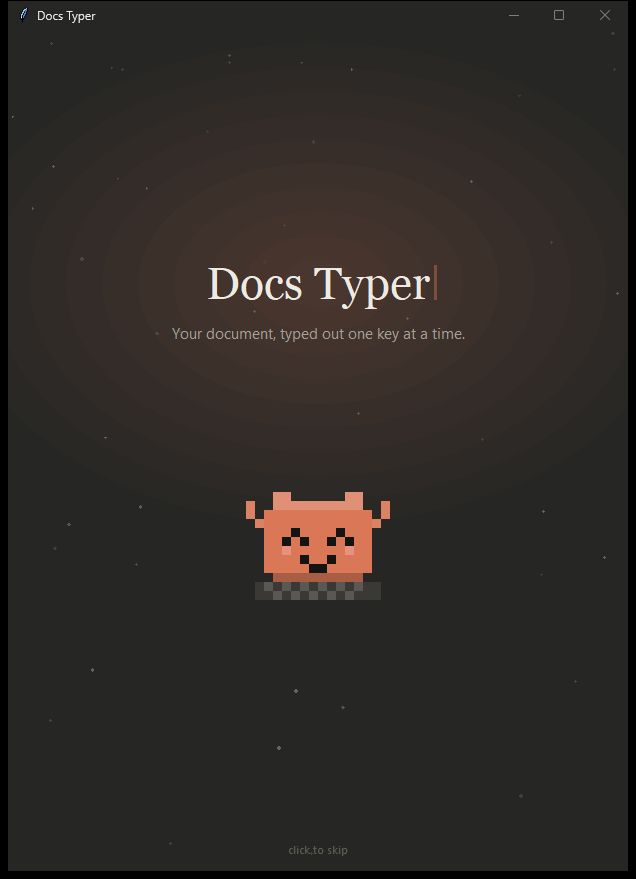
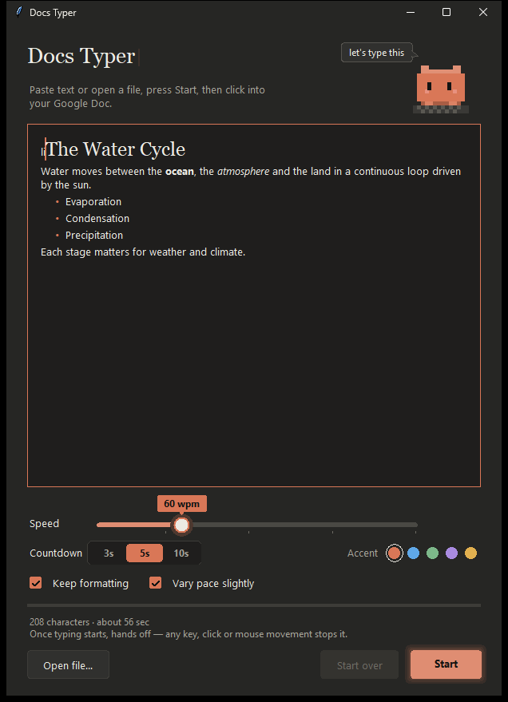
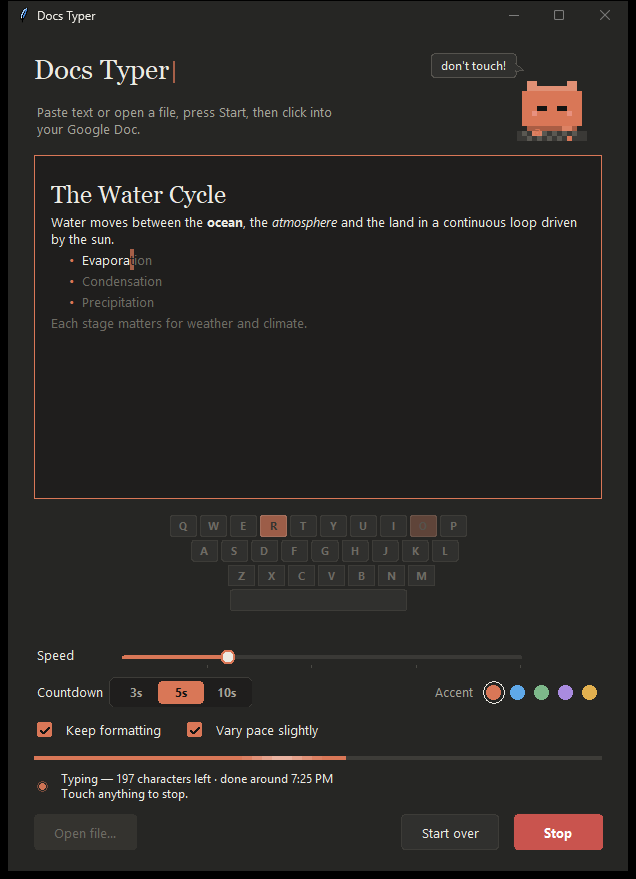

# Docs Typer

Types a document into Google Docs one keystroke at a time, keeping its formatting. It works on
**Windows** and **macOS**.

<p align="center">
  
  
  
</p>

## Install

Copy one line, paste it, press Enter. It downloads Docs Typer, gets Python for it if you don't
have one (you don't need to install anything first), and opens it.

**On a Mac:** open **Terminal** (press ⌘+Space, type `Terminal`, press Enter) and paste:

```bash
curl -fsSL https://raw.githubusercontent.com/4d1t-Codezz/docs-typer/main/install.sh | bash
```

It puts **Docs Typer** in your Applications folder.

**On Windows:** open **PowerShell** (press Start, type `PowerShell`, press Enter) and paste:

```powershell
irm https://raw.githubusercontent.com/4d1t-Codezz/docs-typer/main/install.ps1 | iex
```

It adds **Docs Typer** to your desktop and Start menu.

To update later, run the same line again.

**Mac only: allow permissions.** The first time you press **Start**, macOS asks for
**Accessibility** (so it can type) and **Input Monitoring** (so it can stop when you touch
anything). Turn both on for Docs Typer in **System Settings → Privacy & Security**, then quit and
reopen Docs Typer.

> **Turned it on but it still asks?** Each install counts as a new app to macOS, so an old entry
> won't match. In both lists, select **Docs Typer**, click **−** to remove it, then press **Start**
> again and allow it fresh. Old **python3** entries from an earlier version can be removed too.

<details>
<summary><b>Rather not use Terminal or PowerShell?</b></summary>

Click **[Download ZIP](https://github.com/4d1t-Codezz/docs-typer/archive/refs/heads/main.zip)**,
open the ZIP to unzip it, then double-click **`Install on Mac.command`** or
**`Install on Windows.bat`** in the unzipped folder. It does the same as the line above.
You can delete the folder afterwards.

- **Mac says it "can't be opened" or "Apple could not verify" it?** Click **Done**, then go to
  **System Settings → Privacy & Security**, scroll down and click **Open Anyway** next to
  `Install on Mac.command`.
- **Windows shows "Windows protected your PC"?** Click **More info → Run anyway**.

</details>

<details>
<summary><b>Uninstall</b></summary>

- **Mac:** drag **Docs Typer** from Applications to the Trash.
- **Windows:** delete the **Docs Typer** shortcuts on your desktop and in the Start menu, and the
  folder `%LOCALAPPDATA%\Programs\Docs Typer` (paste that into the File Explorer address bar).

</details>

## Use it

1. **Add your text.** Paste it into the box (Ctrl/⌘+V), or click **Open file…** to load a `.docx`,
   `.rtf`, `.odt`, `.html` or `.txt` file.
2. **Press Start** (or Ctrl/⌘+Enter).
3. **Click into your Google Doc** where the text should go, before the countdown ends.
4. **Hands off.** Don't touch the keyboard or mouse while it types. If you do, it stops. To keep
   going, put your cursor back where it left off and press **Resume**.

Tips:
- Google Docs turns lines starting with `- ` or `1. ` into lists automatically. You can turn that
  off under **Tools → Preferences → Automatically detect lists**.
- To paste text into the box without its formatting, use Ctrl/⌘+Shift+V.

## Features

- **Opens** `.docx`, `.rtf`, `.odt`, `.html` and `.txt` files. You can also paste rich text straight
  from Google Docs or Word.
- **Keeps formatting:** bold, italic, underline, strikethrough, superscript and subscript,
  headings 1–6, bullet and numbered lists with nesting, and alignment. These are recreated with
  Google Docs' own keyboard shortcuts (Ctrl-based on Windows, ⌘-based on Mac).
- **Speed from 10 to 200 wpm**, with an optional *vary pace* mode that adds natural pauses.
- **Retype words** (optional): every so often it deletes the word it just typed and types it
  again, like a second thought. It only does this where the word keeps its formatting.
- **Make mistakes** (optional): now and then it makes a typo (a neighboring key, a doubled, swapped
  or missed letter) or mixes up words like *their/there*, *its/it's* or *then/than*. It notices
  a moment later, backspaces and fixes it, so the finished document is exactly your text.
- **Hands-off safety:** any real key, click, scroll or mouse movement stops typing, and so does
  switching to another app.
- **Live view:** the text in the window lights up as it's typed, a key strip shows each key, and
  the status shows live speed and an estimated finish time.
- **Tappy**, a pixel critter who types along, follows your mouse with its eyes, reacts when you
  stop it and celebrates when it's done.
- A choice of 3, 5 or 10 second countdown, five accent colors, and remembered settings.

## For developers

Run it straight from the repo with `python -m docstyper` (Python 3.10+ with Tk 8.6+).

The installers are `install.sh` (Mac) and `install.ps1` (Windows); the double-click files just run
them. On Windows it copies the app to `%LOCALAPPDATA%\Programs\Docs Typer` and points the shortcuts
at a Python there or one you already have. On a Mac, `scripts/build-mac-app.sh` builds
`dist/Docs Typer.app`. Its launcher (`scripts/mac-launcher.c`) runs Python inside the app so macOS
asks for permissions as Docs Typer, and it's compiled if you have Apple's command line tools;
otherwise the prebuilt universal `scripts/mac-launcher` is used. Rebuild that after changing the
launcher (the command is at the top of `mac-launcher.c`). If no suitable Python is found, both
installers get Python 3.12 with [uv](https://docs.astral.sh/uv/).

### How it works

```
docstyper/
  readers.py      .docx / .odt / .html / .rtf / .txt  →  paragraphs with formatting
  keystrokes.py   paragraphs → a platform-neutral plan of keystrokes and named actions
                  ("bold", "heading2", "bullet", ...), plus the Typer that plays it
  platforms/
    windows.py    SendInput, low-level keyboard/mouse hooks, Win32 clipboard
    macos.py      Quartz CGEventPost, a listen-only CGEventTap, NSPasteboard (via ctypes)
  ui.py           the window; widgets.py, mascot.py, intro.py and motion.py do the animation
```

Each backend maps the named actions to that platform's Google Docs shortcuts. The keystrokes it
sends are tagged, so the input watcher can ignore them and only react to you.

### Tests

```
python -m unittest discover -s tests -t . -v
```

The tests cover the file readers, the keystroke plan, the typing loop (with a fake backend), and
each platform's shortcut table. They also include a UI smoke test that plays the intro and every
animation without sending any input. GitHub Actions runs them on Windows and macOS, and also runs
both installers there, including the one-line versions.
